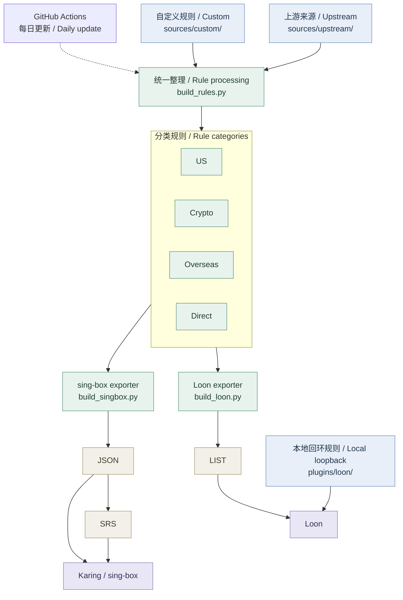

# RoutingRules

RoutingRules 是一个持续维护的网络分流规则集，按服务类型整理域名与 IP 规则，并提供适配不同客户端的订阅文件及网络规则扩展。

RoutingRules is a curated and continuously maintained collection of network routing rules. It organizes domain and IP rules by service category and publishes client-specific subscription files and network rule extensions.

## 架构 / Architecture

统一整理规则，按客户端格式发布。上游来源与自定义规则独立维护，特定网络场景的规则扩展以客户端插件形式提供。 / Rules are processed centrally and published in client-specific formats. Upstream sources and custom rules are maintained separately; specialized network rules are provided as client-specific plugins.

## 规则分类 / Rule Categories

| 分类 / Category | 内容 / Coverage |
| --- | --- |
| US | AI 服务、Google 生态、全球财经与新闻媒体 / AI services, Google ecosystem, financial news and international media |
| Crypto | 加密资产、钱包、交易平台及行情工具 / Crypto assets, wallets, exchanges and market analytics |
| Overseas | GitHub、国际网站及网络工具 / GitHub, international websites and online utilities |
| Direct | 中国大陆常用服务、银行、支付及 Apple 服务 / Mainland Chinese services, banking, payments and Apple services |

## 订阅地址 / Subscriptions

选择客户端对应的格式，复制链接添加至远程规则或 Rule Set，为各分类配置所需的连接策略。

Choose the format for your client, copy its URL into a remote rule or rule set, and assign a connection policy to each category.

| 分类 / Category | Loon (LIST) | Karing / sing-box (SRS) | sing-box (JSON) |
| --- | --- | --- | --- |
| US | [US.list](https://raw.githubusercontent.com/linjiayinchn/RoutingRules/main/subscriptions/loon/US.list) | [US.srs](https://raw.githubusercontent.com/linjiayinchn/RoutingRules/main/subscriptions/sing-box/US.srs) | [US.json](https://raw.githubusercontent.com/linjiayinchn/RoutingRules/main/subscriptions/sing-box/US.json) |
| Crypto | [Crypto.list](https://raw.githubusercontent.com/linjiayinchn/RoutingRules/main/subscriptions/loon/Crypto.list) | [Crypto.srs](https://raw.githubusercontent.com/linjiayinchn/RoutingRules/main/subscriptions/sing-box/Crypto.srs) | [Crypto.json](https://raw.githubusercontent.com/linjiayinchn/RoutingRules/main/subscriptions/sing-box/Crypto.json) |
| Overseas | [Overseas.list](https://raw.githubusercontent.com/linjiayinchn/RoutingRules/main/subscriptions/loon/Overseas.list) | [Overseas.srs](https://raw.githubusercontent.com/linjiayinchn/RoutingRules/main/subscriptions/sing-box/Overseas.srs) | [Overseas.json](https://raw.githubusercontent.com/linjiayinchn/RoutingRules/main/subscriptions/sing-box/Overseas.json) |
| Direct | [Direct.list](https://raw.githubusercontent.com/linjiayinchn/RoutingRules/main/subscriptions/loon/Direct.list) | [Direct.srs](https://raw.githubusercontent.com/linjiayinchn/RoutingRules/main/subscriptions/sing-box/Direct.srs) | [Direct.json](https://raw.githubusercontent.com/linjiayinchn/RoutingRules/main/subscriptions/sing-box/Direct.json) |

### 快速开始 / Quick Start

**Loon:** 在规则设置中添加远程规则，填入 LIST 地址并选择策略。 / Add a remote rule using its LIST URL and select a policy.

**Karing:** 在分流规则中添加自定义规则组，填入 SRS 或 JSON 地址并选择策略。 / Create a custom diversion group, add the SRS or JSON rule-set URL, and select a policy.

建议从 US → Crypto → Overseas → Direct 的顺序开始配置，按实际需要调整优先级和默认策略。 / A suggested starting order is US → Crypto → Overseas → Direct. Adjust priority and the default policy to suit your setup.

## 规则扩展与插件 / Rule Extensions & Plugins

针对特定网络场景，项目同时提供可独立启用的客户端规则插件。 / The project also provides independently enabled rule plugins for specialized network scenarios.

| 客户端 / Client | 插件 / Plugin | 功能 / Features |
| --- | --- | --- |
| Loon | [Device Loopback](https://raw.githubusercontent.com/linjiayinchn/RoutingRules/main/plugins/loon/Device_Loopback.plugin) | 通过 Loon 处理本地开发服务的回环连接，使兼容的 iOS 开发工具能够在使用 Loon 时访问本地服务，避免为此反复切换 LocalDevVPN。 / Handles local development loopback traffic through Loon, allowing compatible iOS development tools to access local services without repeatedly switching to LocalDevVPN. |

在 Loon 的插件页面添加对应链接即可使用。 / Add the plugin URL in Loon's plugin settings.

## 自动更新 / Automatic Updates

项目每天同步上游规则，与自定义规则统一整理、去重及校验，并生成各客户端的订阅文件。 / Upstream and custom rules are merged, deduplicated and validated daily before being exported into client-specific subscription files.

更新计划 / Schedule: **00:17 UTC (08:17 UTC+8)**

## 项目结构 / Project Structure

| 目录 / Directory | 用途 / Purpose |
| --- | --- |
| [sources/upstream/](sources/upstream/) | 上游来源配置 / Upstream source registry |
| [sources/custom/](sources/custom/) | 自定义规则 / Curated custom rules |
| [subscriptions/](subscriptions/) | 按客户端格式发布的规则 / Client-specific subscriptions |
| [scripts/](scripts/) | 统一规则整理及各格式生成 / Shared rule processing and format-specific exporters |
| [plugins/](plugins/) | 客户端规则扩展 / Client-specific rule plugins |
| [.github/workflows/](.github/workflows/) | 自动更新与发布 / Automated updates and publishing |

基础规则来源包括 [blackmatrix7/ios_rule_script](https://github.com/blackmatrix7/ios_rule_script)，并结合本项目维护的服务域名。 / Base rules draw on [blackmatrix7/ios_rule_script](https://github.com/blackmatrix7/ios_rule_script), supplemented by curated service domains.

欢迎通过 Issues 或 Pull Requests 提供建议与补充规则。 / Suggestions and contributions are welcome through Issues and Pull Requests.
